# Wiyard

## Overview

Wiyard is a WebAudio-based plugin host application.

You can connect multiple plugin units such as sequencers, drum machines, and effects, and play them in sync.

It adopts the Wafer protocol/framework, which lets various WebAudio apps work together, and it comes with many built-in units that support it.

The screen layout integrates a wire-connected graph UI with a multi-window desktop. You can edit multi-part sequences with the built-in piano roll and create short looping grooves.

The wiring features and UI are inspired by Patcher in FL Studio. Multiple note-channel inputs, the piano roll, and the desktop-style UI are implemented with an original concept so that phrases can be created entirely within the application.

## Architecture

Built with React/Vite/TypeScript. It runs as a standalone frontend and is deployed on Cloudflare Pages.

## Build/Debug

```
pnpm install
pnpm run dev
```

This starts the Vite dev server. On the first run, Wafer's Vite plugin fetches the required units from their repositories.

## How to use the application

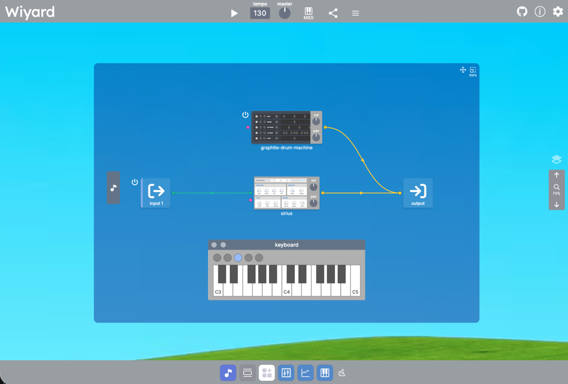

Open https://wiyard.pages.dev to start the application. This is what it looks like on first launch.

The desktop contains a graph UI for wiring units; it is the blue area in the image above. Several windows appear in front of it. Initially, the keyboard window is displayed.

### Navigating the view

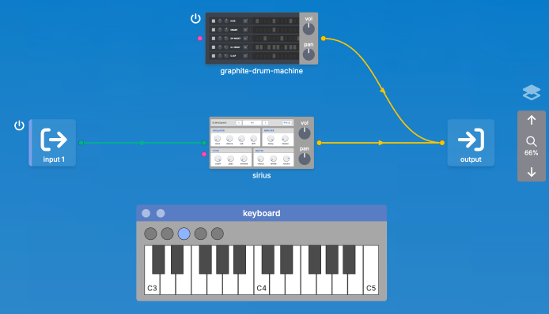

Drag an empty area of the background to pan the view. Drag the scaling slider at the right edge of the screen up or down to zoom.

### Adding units


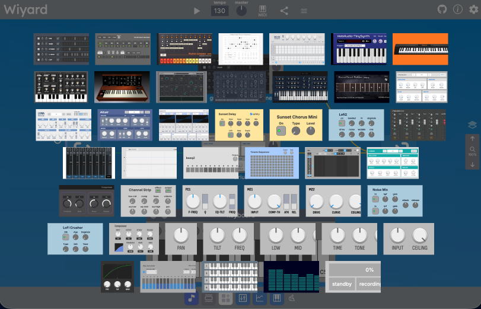

Press the white icon button at the bottom of the screen to open the plugin-unit picker. Drag and drop the unit you want from here into the graph editing area.

### Moving cards

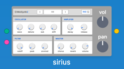

Drag a unit card to move it.

### Window controls

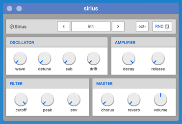

Tap a unit card in the graph editing area to open its window. Drag its title bar to move it, and drag any of its four corners to resize it. The title bar contains minimize and close buttons.

### Taskbar window management


The taskbar contains window-control buttons, a plugin-picker button, icons for built-in units, and icons for minimized windows. Minimizing a window adds its icon on the right. Press the brush button to clear minimized windows. The leftmost icon toggles the piano roll window; the following desktop-view button toggles minimizing and restoring every window except the piano roll.

### Piano roll window side button


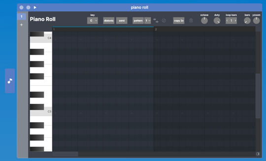

The piano roll is often used at a large size and shown or hidden frequently, so it has an additional side button. Press it to toggle the window's visibility.

### Wiring

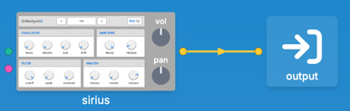

Connect the ports on the left and right sides of unit cards to create wires. Input ports are on the left and output ports are on the right. Ports and wires are color-coded: green for note signals, yellow for audio signals, and pink for automation signals. Only ports of the same color can be connected. Tap a port to connect it to the nearest compatible port, or drag it to connect it to any other compatible port.

When a port has one connection, tap it to remove that wire. When it has multiple connections, drag from the port to a destination to remove that specific wire.

### Adding note channels

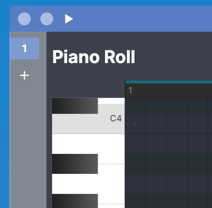

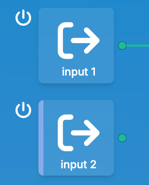

Select a note input port and tap it again to open the piano roll window. Tap the `+` button in the left column of the piano roll to add a channel; a corresponding port is added to the graph as well. Up to four note channels/ports can be created.

### Switching the active note channel

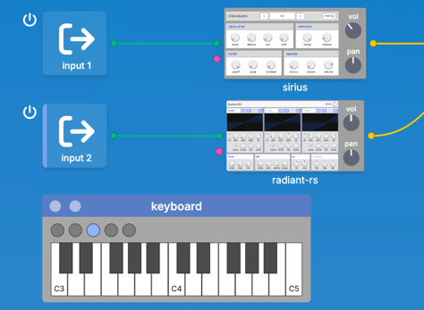

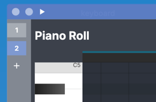

One note channel is active at a time. Input from the on-screen or MIDI keyboard is sent to that channel. Tap a note port to select it; a purple border appears at the left edge of its icon. This selection is synchronized with the channel-selection button in the piano roll's left column.

### Playing a sequence


Use the Play button in the top bar to play the scene. Drum machines and sequencers/piano rolls run in sync with the main clock. Drag the tempo UI vertically to change the BPM, and adjust the master volume to control the output level.

### Switching parts on/off, mute, and solo

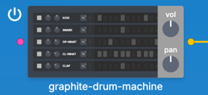

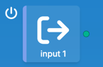

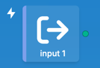

A power-button icon appears beside each note-channel port connected to a piano roll and beside drum machines. Tap it to turn that part on or off. Hold the icon to play the part solo; the icon changes to a lightning bolt.

### Deleting units and toggling side controls

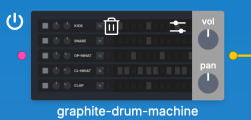

Hold a unit card to dim its display and show a trash button. Press that button to delete the unit.

For cards that output sound, such as instruments and effects, holding the card also shows a slider icon in the upper-right corner. Press it to toggle the volume and pan controls on the card's right side. These controls are enabled by default for instruments such as synths and drum machines. They are disabled by default for effects, but can be enabled as an option.

### Wire volume knob


Hover the mouse pointer over the arrow icon in the middle of an audio-signal wire (yellow) to show the wire volume knob. Use it to adjust the volume of the signal through that wire.

### Graph surface layout controls

<!--  -->

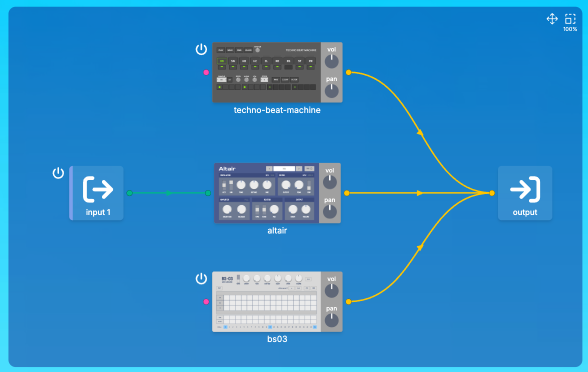

Drag any of the graph surface's four corners to resize the graph editing area.


The upper-right corner of the graph surface has controls for arranging the graph contents. Drag the move control to change their relative position, and drag the scale control to change their scale.

### Elevation

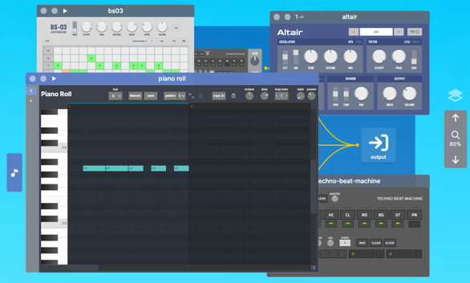

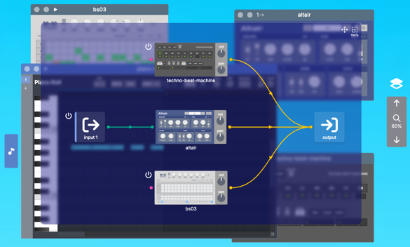

In Wiyard, the graph editing UI sits on the desktop surface with windows placed on top of it, which means you cannot edit the graph unless you close the windows or move them aside. To improve this, a display feature called elevation has been added. Tap the layer icon above the scaling slider on the right side of the screen, and the graph surface that was behind the windows is brought to the front, allowing you to edit the graph on top of the windows. By default it is displayed semi-transparent with a blurred background. If it is hard to see, you can change it to opaque or semi-transparent without blur in the settings.

### Project menu


Press the menu icon at the far right of the top bar to show project controls. Their functions are as follows.

#### starter

Resets to the initial state. A note channel is connected to the default synth and the keyboard is shown on screen, so you can immediately confirm that sound is produced.

#### blank

Clears all units and wires, leaving only the default ports. Start here when building a new scene.

#### demo

Loads a demo project. Press Play to hear its sequence.

#### import

Select and load a project JSON file from the operating system's file system.

#### export

Save the current project as a JSON file to the operating system's file system.


The top bar also contains a share-icon button. Press it to copy a URL with the current project state embedded in it to the clipboard. The domain name of a sharing URL includes the application's deployment ID, so the URL is pinned to the version of the application current when it was generated.

### Using a MIDI keyboard


To use a MIDI keyboard, press the MIDI icon button in the top bar. Depending on the browser, a permission dialog will appear; please grant the permission.

### Built-in keyboard unit

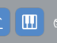

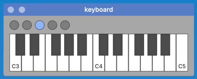

Tap the keyboard icon in the taskbar to display it. The built-in keyboard is connected to the active note channel. Touch keys to play notes, and use the LED button to change the octave shift.

Notes received from an external MIDI keyboard are routed to the active note channel through this built-in keyboard unit. Its octave-shift setting also applies to notes from the external MIDI keyboard.

### Control Surface

With Control Surface, you can assign MIDI Control Change messages to up to eight knobs and connect them to parameters of any unit in the graph.

#### Connecting to parameters

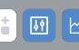

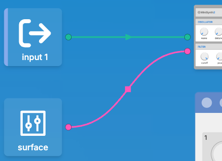

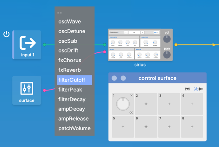

Tap the icon on the taskbar to open the control surface window.
Press the + button in slots 1-8 to enable the knob in that slot. A surface card is placed on the screen with a pink port. Drag the port to connect it to a target unit such as a synth. A square marker appears at the midpoint of the wire. Tap it to display a list of target parameters, and select the parameter to connect to. The control surface knob and the synth's parameter knob are now linked.

#### Mapping MIDI controller knobs

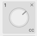

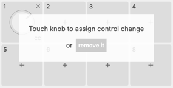

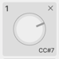

Each Control Surface knob slot has a `CC` label in its lower-right corner. Press it to enter a mode that waits for a MIDI CC message, then move a knob on your controller to assign a control change. When successful, it displays `CC#number`. Control-change assignments are stored in the application settings, not in the project. The intended workflow is to keep the mapping from a MIDI controller to Control Surface fixed, while assigning Control Surface controls to synths and other units separately for each project.

#### Switching modes

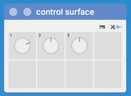

When the wrench icon is active, editing mode lets you add or remove knobs and edit control-change assignments. The space-shuttle icon enables operation mode, which locks editing to prevent accidental changes.

#### Switching layouts

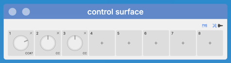

Use the layout button to switch between 4×2 and 8×1 layouts.

### Automation editor

#### Connecting to parameters

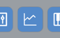


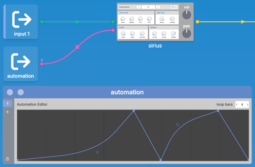

Tap its taskbar icon to display the window. By default, there are no automation channels. Press the `+` button in the left column to add one. Assign output parameters in the same way as for Control Surface.

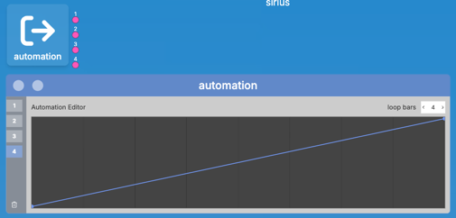

The automation editor supports up to four channels. Press the `+` button in the left column to add a channel; a corresponding port is added to the card in the graph editing area.

#### Editing curves

Automation runs in loops from 1/4 bar to 64 bars long. Set the length with the loop-bars selector.

Tap a line to add a point, drag a point to move it, and tap a point to delete it. Hold a point to switch its type between corner and curve.

### Piano roll

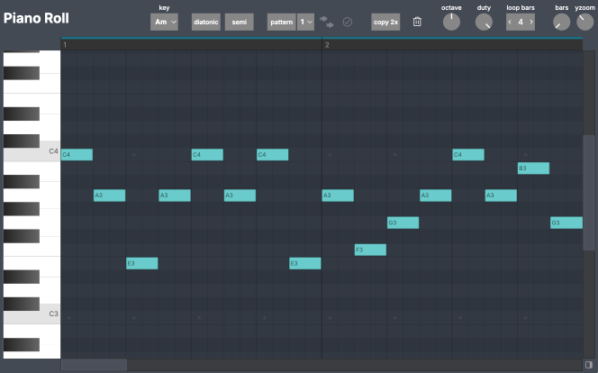

Use the built-in piano roll to enter sequence patterns up to 16 bars long. Patterns play in a loop.

#### Controlling the visible range

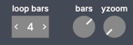

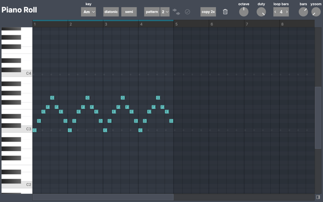

Use the bars knob in the upper-right to change the number of visible bars. A larger value shows a wider range. Use the yzoom knob to adjust vertical magnification.

Set the loop length with the loop-bars selector. Choose a power-of-two loop length between 1/4 and 16 bars.

When a note is placed outside the loop, the loop length automatically expands to include it. The loop region is highlighted in green on the index bar above the editing area. You can also change the loop length by tapping the index bar.

Use the horizontal scrollbar to change the position shown on the timeline, and the vertical scrollbar to change the pitch range shown.

#### Editing notes

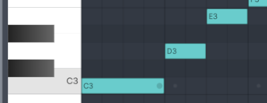

Drag rightward from an empty area to enter a new note.

Drag an existing note to move it. Hover a note to show a dot at its end; drag that dot to change the note duration.

Tap an existing note briefly to delete it.

The note-placement grid is determined automatically by the visible range along the timeline. Zoom in horizontally to edit at a finer resolution.

#### Pattern feature

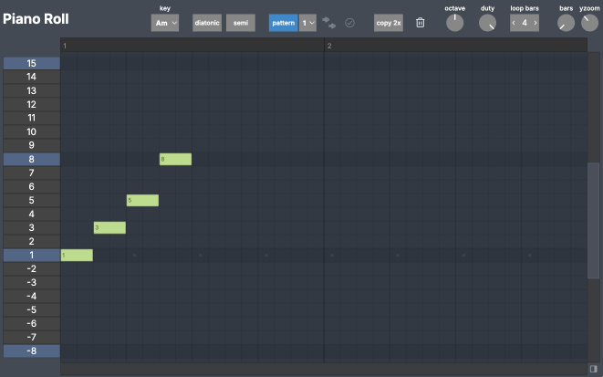

There is a pattern feature that makes it easy to enter chords and arpeggios using relative scale degrees. Press the pattern button to switch to the pattern editing screen. Enter the notes of the pattern here.

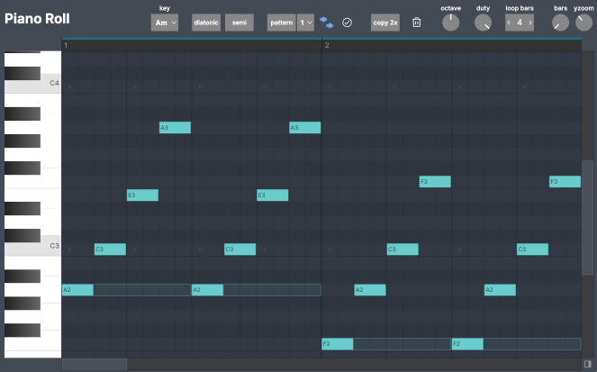

Return to the main screen and enable the pattern apply button with the fish icon. When you enter a note, multiple notes are placed, shifted by relative scale degrees according to the pattern definition.

There are two algorithms for placing pattern notes, which can be switched with a selector.
Algorithm 1 adds all notes of the pattern definition in their relative arrangement for each entered note. Algorithm 2 keeps the time-axis arrangement of the pattern and places pitch-shifted notes, copying them repeatedly within the span of the entered note.

When moving notes with a pattern applied, each note is updated together while maintaining their relative intervals.

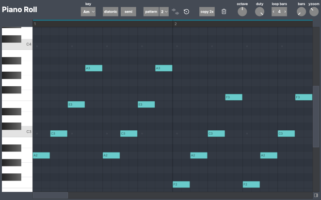

Press the checkbox button to the right of the fish icon to finalize the pattern-applied edit and materialize the notes. The separated notes can then be edited individually.

Press the button again to cancel the individual note edits and return to the state as of the last edit in pattern apply mode.

#### Diatonic display

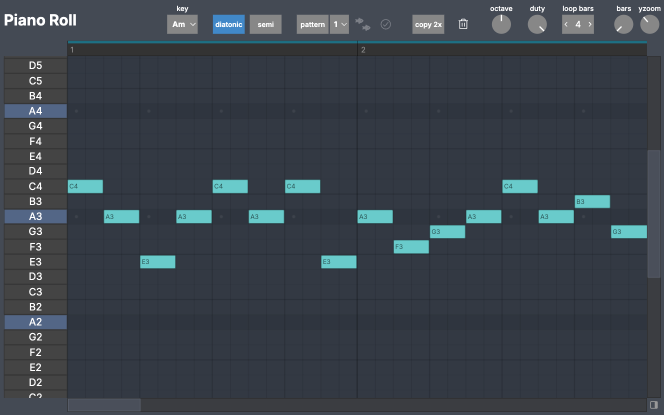

There is a diatonic view mode that displays notes by pitches within a scale for a specified key. Select the key with key, and enable this mode with the diatonic button. The vertical grid then becomes scale-note units.

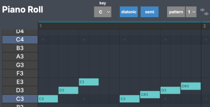

When the semi button is disabled, notes can only be placed on the scale's seven pitches. Enable semi to also place semitone notes between scale notes.

#### Copy / delete-note buttons


The copy 2x button copies notes in units of the range of currently entered notes rounded to the loop length, doubling the loop length.

Press the trash icon button to delete all notes.

#### Octave / duty knobs

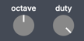

The octave knob sets the octave shift. It shifts only the octave up or down while keeping the arrangement of the entered notes. There are 5 steps: -2, -1, 0, 1, 2.

The duty knob changes the length of notes by a uniform ratio. Use it when you want to shorten notes while keeping each note's start position.

#### Page-based range controls

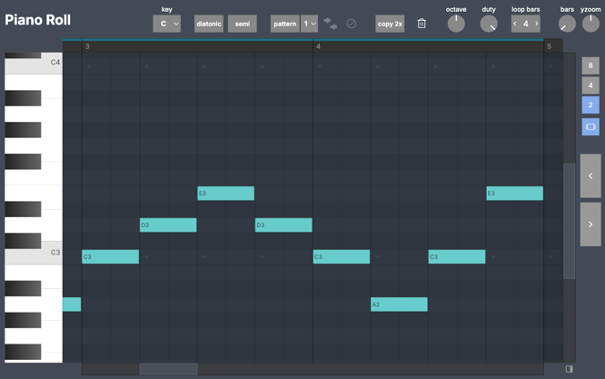

Tap the icon at the lower right to display a column of buttons on the right side. Use this when you want to switch the editing width and position along the time axis in whole-bar units. Choose the number of bars to display with the 2/4/8 buttons. The arrow buttons shift the display range left and right by the number of displayed bars.

The side margin icon button below the bar count buttons enables an option that adds a short margin on the left and right of the display. When entering melodies, this lets you see the ending note of the previous section at the left edge, helping you grasp the note arrangement.

### Settings


Tap the gear icon in the upper-right corner to open the settings screen.

#### General settings

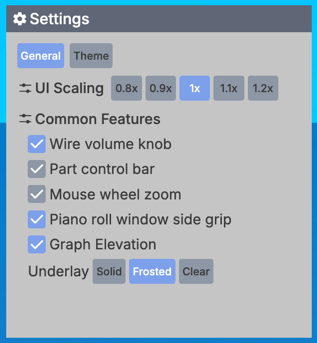

##### UI Scaling

Adjusts the display scale of the entire screen.

##### Wire volume knob

Controls whether wire volume knobs are shown. When volume knobs are hidden, wire gain is not applied.

##### Part control bar

Shows a panel of on/off buttons for all parts at the left edge of the screen.

##### Mouse wheel zoom

Allows the mouse wheel to control zoom on the desktop surface.

##### Piano roll window side grip

Shows a button on the left side of the piano roll window to toggle its visibility.

##### Graph Elevation

Controls whether Graph Elevation is available. You can also choose an opaque, blurred, or semi-transparent display for the area behind the graph.

#### Theme

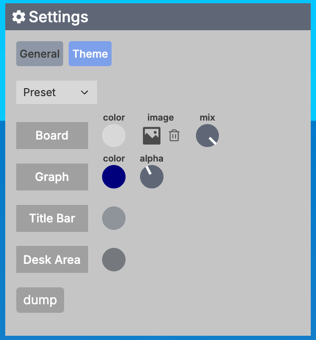

Customize the desktop theme.

Choose a preset theme with the selector.

You can set the colors and opacity of the board, graph section, title bars, and more. Load an image file from the file system to use any wallpaper as the board background.

## License

MIT License.

## References

### [Wafer](https://github.com/yahiro07/wafer)

The plugin protocol and host framework.

### [wafer-units](https://github.com/yahiro07/wafer-units)

Repository of original plugin units.

### [wafer-custom-units](https://github.com/yahiro07/wafer-custom-units)

Repository of plugin units adapted to Wafer from OSS WebAudio apps.
